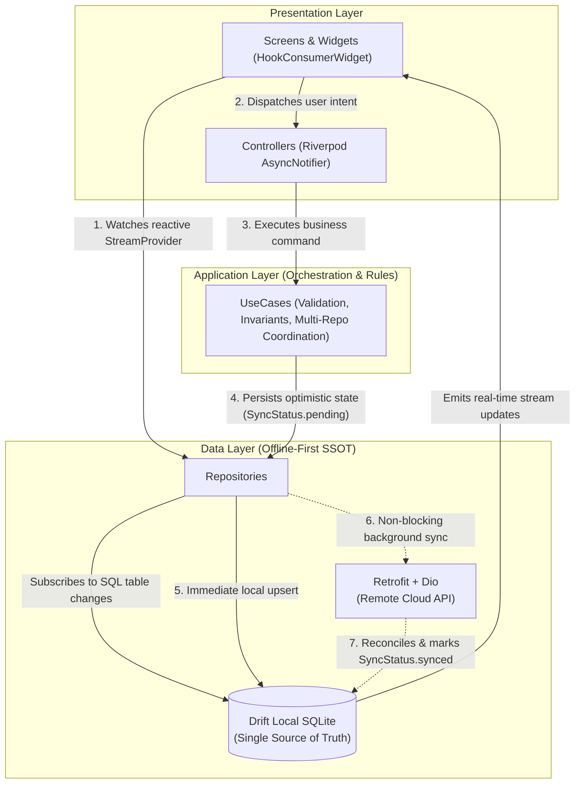

# Notes — Offline-First Reactive Workspace

A modern, offline-first note-taking application engineered with **Flutter**, **Drift (SQLite)**, **Riverpod**, and **AutoRoute**. Designed around a **Single Source of Truth (SSOT)** reactive architecture that guarantees zero-latency local interactions and resilient background cloud synchronization.

---

## Key Highlights

- **True Offline-First Engine**: Powered by **Drift (SQLite)**. Every read is a reactive database stream; every write is committed locally in under 2ms with optimistic UI updates and background outbox synchronization.
- **Pragmatic Clean Architecture**: Combines strict domain separation (UseCases for validation, invariants, and orchestration) with direct reactive streams—eliminating ceremonial pass-through layers and redundant mapper bloat.
- **Reactive State & Lifecycle Management**: Built on **Hooks Riverpod** (`AsyncNotifier`, `StreamProvider`, and `HookConsumerWidget`) for declarative state and automatic resource disposal.
- **Declarative Routing & Deep Linking**: Configured with **AutoRoute** and reactive authentication guards for seamless navigation and deep-link resolution.
- **Type-Safe Networking & Serialization**: Uses **Retrofit + Dio** for REST communication and **Dart Mappable** for zero-boilerplate serialization, value equality, and immutable state updates.

---

## Architecture Overview



---

## Tech Stack

| Layer | Technology | Role |
| :--- | :--- | :--- |
| **UI & Hooks** | `flutter_hooks`, `flutter_svg` | Ephemeral widget lifecycle management & vector asset rendering |
| **State & DI** | `hooks_riverpod`, `riverpod_annotation` | Reactive dependency injection, stream binding, and async controllers |
| **Navigation** | `auto_route` | Strongly-typed routing, route guards, and deep-link handling |
| **Persistence** | `drift`, `drift_flutter` | Reactive relational SQLite database (Single Source of Truth) |
| **Networking** | `retrofit`, `dio` | Declarative REST clients and HTTP interceptors |
| **Models** | `dart_mappable` | Immutable domain models, deep `copyWith`, and JSON mapping |

---

## Project Structure

```text
lib/
├── main.dart                          # Application entry point & ProviderScope
├── app/
│   ├── app.dart                       # Root MaterialApp.router configuration
│   ├── router/                        # AutoRoute definitions, Deep Linking & AuthGuard
│   └── theme/                         # Design system, colors & FugazOne typography
├── core/
│   ├── database/                      # Drift SQLite database & table declarations
│   ├── error/                         # Typed domain & infrastructure exceptions
│   ├── network/                       # Dio client & auth token interceptor
│   └── sync/                          # Offline synchronization state primitives
└── features/
    ├── auth/                          # Authentication & local session management
    │   ├── domain/                    # AuthUser model
    │   ├── data/                      # Drift session DAO, Retrofit API & AuthRepository
    │   ├── application/               # LoginUseCase (Validation & session orchestration)
    │   └── presentation/              # AuthController & LoginScreen
    └── notes/                         # Offline-First Notes Engine
        ├── domain/                    # Note model with SyncStatus metadata
        ├── data/                      # Reactive NotesDao, Remote API & Sync Repository
        ├── application/               # SaveNoteUseCase & DeleteNoteUseCase
        └── presentation/              # Reactive stream providers, controllers & screens
```

---

## Getting Started

### 1. Install Dependencies
```bash
flutter pub get
```

### 2. Run Code Generation
Whenever models, routes, database tables, or annotated providers change, run:
```bash
dart run build_runner build --delete-conflicting-outputs
```

### 3. Launch the Application
```bash
flutter run
```
